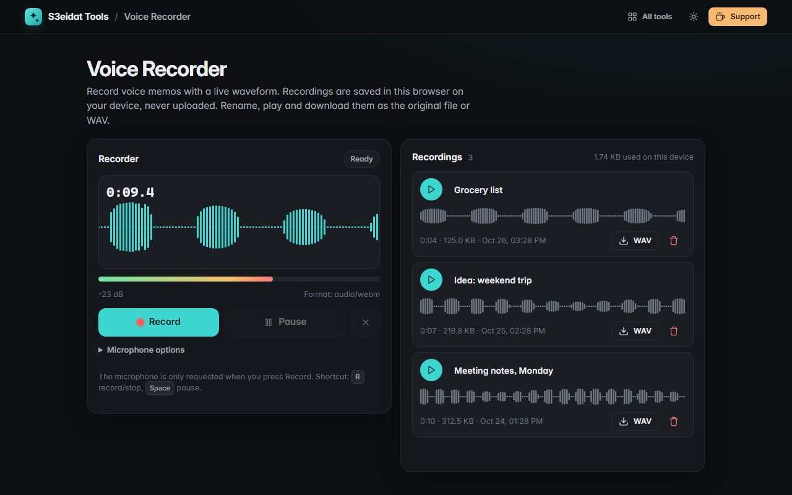

# Voice Recorder

> Record voice memos with a live waveform. Free, private, and it runs entirely in your browser.

### ▶ [Open Voice Recorder](https://s3eidat.github.io/voice-recorder/)



## Features

- **Record** from your microphone with a live scrolling **waveform**, **level meter** and dB readout
- **Pause / resume**, stop & save, or discard a take
- **Recordings list** saved in your browser (IndexedDB), so memos are still there next visit
- **Rename**, **play** with a clickable waveform to seek, **delete**
- **Download** the original file (WebM/Ogg/M4A, whatever your browser records) or **convert to WAV**
- **Noise suppression**, echo cancellation and auto gain toggles (turn off for music)
- Keyboard: <kbd>R</kbd> record/stop, <kbd>Space</kbd> pause/resume

## Privacy

Your recordings never leave your device. They're stored in this browser's own storage until you delete
them. There is no server, no account, no analytics. The page ships with a strict Content-Security-Policy
(`connect-src 'self'`), so the browser itself blocks any attempt to send data anywhere. The microphone
is only requested when you press **Record**.

## Run it yourself

It's plain HTML, CSS and JavaScript with no build step:

```bash
git clone https://github.com/s3eidat/voice-recorder
cd voice-recorder
python -m http.server 8000
```

Then open http://localhost:8000 (the microphone needs `localhost` or HTTPS).

## Support

If this saved you time, **[buy me a coffee ☕](https://s3eidat.github.io/coffee/)**. It keeps every tool free.

---

Part of **[S3eidat Tools](https://s3eidat.github.io/)**: 100+ free, private tools that run in your browser. MIT licensed.
